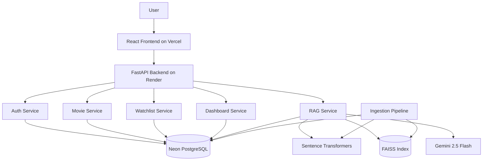

# CineMind AI Architecture

The backend follows a router-service-repository layout. Routers handle HTTP contracts, services hold business rules, repositories isolate SQLAlchemy access, and AI/vector modules isolate model providers.

